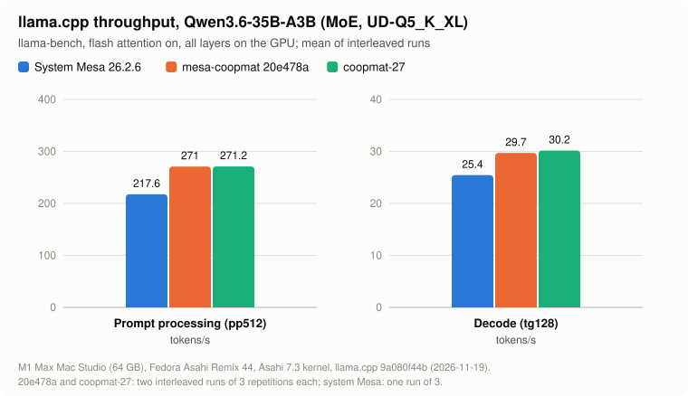
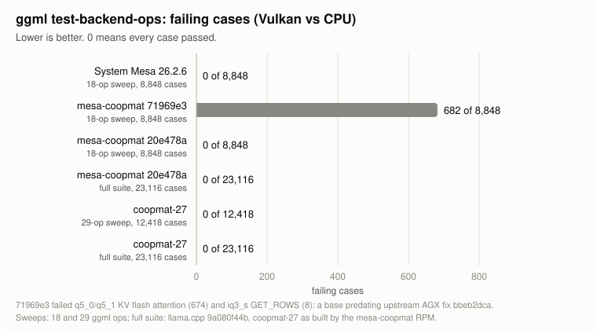
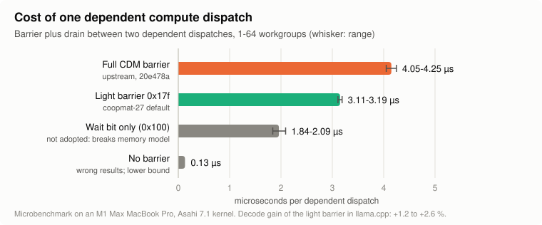

# aquarat/mesa: Honeykrisp compute work for Apple M1/M2 GPUs

This is a personal fork of [Mesa](https://gitlab.freedesktop.org/mesa/mesa).
Its `coopmat` branches carry changes to Honeykrisp, Mesa's Vulkan driver for
Apple M1/M2 GPUs (`src/asahi`). They are aimed at GPU compute: llama.cpp and
other ggml programs, stable-diffusion.cpp, and CLIP embeddings. The `main`
branch is plain upstream Mesa. Mesa's own README is
[`README.rst`](../README.rst).

> [!IMPORTANT]
> **This work was developed with LLM assistance, and it is not submitted to Mesa.**
> Most commits were written with an AI coding assistant and say so in a
> `Co-Authored-By` trailer; the measurements were made on the owner's
> machines.
> - Mesa requires AI involvement to be disclosed
>   ([`docs/submittingpatches.rst`](https://gitlab.freedesktop.org/mesa/mesa/-/blob/main/docs/submittingpatches.rst)).
>   Mesa's [`AGENTS.md`](https://gitlab.freedesktop.org/mesa/mesa/-/blob/main/AGENTS.md)
>   keeps AI-made changes out of `src/asahi` and `src/poly`.
> - The Asahi Linux project forbids generative-AI tooling for material
>   contributions, because of its clean-room reverse-engineering requirements:
>   see the [Asahi Linux generative AI policy](https://asahilinux.org/llm-policy/).
>   **If you contribute to Asahi, read that policy before you read the code
>   here.**
>
> The descriptions and measurements below are offered as information. They
> are not a patch submission. Problems with this driver go to this fork, not
> to Mesa or Asahi Linux.

## Branches

| branch | base | what |
|---|---|---|
| `coopmat-27` | Mesa main `23732583a81c` (2026-11-19, `27.0.0-devel`) | the current series: 42 commits, described below |
| `coopmat` | Mesa main `063a4640270b` (2026-08-26, `26.3.0-devel`) | the previous series (tip `f4ccb8c4`), kept unchanged as the reference. The current packaged driver, `20e478a1ab11`, is this branch before the light-barrier merge. It has the same 42 commits, plus three AGX compiler fixes cherry-picked from later Mesa main (`bebbaf49`, `bbeb2dca`, `b47973d0`). |

`coopmat-27` is `coopmat` rebased onto current Mesa main. Three commits were
dropped because they are upstream now: the three AGX compiler fixes. The
other 42 applied unchanged, apart from a one-line adjustment in KosmicKrisp's
`kk_shader.c`, where the TCS packing change adds an argument to
`poly_nir_lower_tcs` and upstream had restructured the surrounding function.
Nothing else from the series has landed upstream.

The packaged form of the driver is `mesa-coopmat` in
[apple-silicon-kernel-plus](https://github.com/aquarat/apple-silicon-kernel-plus)
(`packages/mesa-coopmat`). It is a parallel install with its own ICD file,
used opt-in per process.

## What the series contains

The hashes below are on `coopmat-27`, oldest first within each group.

### 1. `VK_KHR_cooperative_matrix` (prototype)

| commit | change |
|---|---|
| `f20b82f0d` | `VK_KHR_cooperative_matrix` for compute, built on the G13 `simd_matrix_fmadd` instruction: an 8x8x8 SIMD-group multiply-accumulate where each lane holds two elements of a tile, in Metal's `simdgroup_matrix` layout. It adds an `agx` opcode and a `cmat_muladd_agx` NIR intrinsic, plus `hk_nir_lower_cooperative_matrix`, adapted from panvk's pass: matrices are split into 8x8 tiles, and loads and stores address the tile layout. It advertises 16x16x16 and 8x8x8 subgroup-scope shapes for f16/f16/f32, f16/f16/f16 and f32/f32/f32. |
| `d2a33a6eb` | Use the native mixed f16 x f16 + f32 form: the per-operand size flags are honoured, and the instruction's f32 variant bit follows the accumulator. This was checked bit-exact on G13G. `HK_CMAT_WIDEN=1` restores the earlier path, which widens A and B to f32 for experiments. |
| `4671b92ac` | Register allocation fix: a `simd_matrix_fmadd` destination must never overlap its A or B register pairs. |

ggml's Vulkan backend picks this up automatically for matrix multiplication
and flash attention (`matrix cores: KHR_coopmat` in its device line). Limits:
compute stage only, subgroup scope only, no robust buffer access for
cooperative matrices (`cooperativeMatrixRobustBufferAccess = false`), and only
the shapes listed. Tested on M1 Max (G13C) and M1 Pro.

### 2. Dispatch overlap and the light dependency barrier

AGX compute dispatches in one control stream are separated by a CDM barrier
block. Upstream emits that block with every cache bit set after every
dispatch, which serialises the dispatches and adds the cost of a full cache
flush.

| commit | change |
|---|---|
| `04e0ce77d` | Skip the post-dispatch cache flush where the internal caller says it is not needed. |
| `0ae7af4a6` | Let independent application dispatches overlap. They get a barrier block with a chosen subset of cache bits (`hk_cdm_barrier_masked`), and a lazy full flush is settled at the stream end, before any driver-internal kernel and before any indirect dispatch. |
| `43ed4b345` | Enable that overlap by default (`HK_PERFTEST=nooverlap` turns it off). |
| `ad76fc1fa` | Use bit 7 alone as the weak barrier between independent dispatches. A per-bit sweep showed that bits 7 and 17-19 are free, while the earlier 0x1f still serialised. |
| `fec2e5bc1` | Serve buffer-only compute-to-compute pipeline barriers inside the open control stream with a lighter barrier word, 0x17f (bits 0-6 and 8), instead of ending the stream with the full flush. "Buffer-only" means global/buffer barriers between compute, transfer, copy or clear stages, from shaders proven before descriptor lowering to use no images, textures, texel buffers or samplers. Everything else keeps the full path. `HK_DEP_BARRIER_MASK` overrides the word; `HK_PERFTEST=fullbarrier` disables the path. |
| `eb6631892`, `5956a5be4` | Record which subqueue direction a light barrier waits in, and keep graphics-to-compute waits when subqueue overlap (group 3) is on. |

Upstream merge request [!44041](https://gitlab.freedesktop.org/mesa/mesa/-/merge_requests/44041),
by another author, proposes a similar lighter CDM barrier. The word here is
a superset of the one tried there.

### 3. Render/compute subqueue overlap (off by default)

| commit | change |
|---|---|
| `57b425a9c` | AGX has separate render (VDM) and compute (CDM) subqueues, and Honeykrisp made every command wait on both. This commit takes the cross-subqueue wait only where a dependency exists: pre-graphics compute feeding a render, post-graphics compute after it, pipeline barriers that name both sides, events, timestamp flushes, and the first command of each type in a submit. |
| `ac3dfc31f` | Take cross-subqueue waits only in the direction the barrier expresses. |
| `c9cc1aa2b` | Turn it off by default. The overlap was real and passed about 38,000 CTS tests, but the frame rate of the game it was written for did not move (22.40 vs 22.56 fps). `HK_PERFTEST=xoverlap` turns it on. |

### 4. GPU profiling counters (`HK_GPUTIME`)

Asahi exposes no GPU utilisation counter. These commits use the firmware's
own start and end timestamps, which every render and compute command can
write, to measure where GPU time goes.

| commit | change |
|---|---|
| `10914b3ea` | `HK_PERFTEST=noflush`: skip all CDM cache flushes. This is a measurement-only bound on the barrier cost and renders incorrectly. |
| `f49ed8245`, `3f756cc34` | `HK_GPUTIME=<seconds>` reports vertex, fragment and compute GPU time and their union (GPU busy), with the frame rate, to stderr. |
| `5fabcb640`, `b2ed82719` | Attribute compute dispatches to their origin: the application, `vk_meta`, geometry or tessellation emulation, or libagx helpers. Rank them by shader, and name the driver's own kernels. |
| `40cc2de43`, `80771e22c`, `36662e74a` | Make per-dispatch timing meaningful: end the control stream at a compute timestamp write, and stop `merge_control_streams` from merging timed streams. Report how coarse the firmware's per-command timing really is. |
| `57038b7a7`, `117b2484e` | Per-shader *measured* GPU time and hardware loop counts. A control stream is charged to a shader only when every dispatch in it came from that shader. Fragment time is attributed to the shader that ran. |
| `315cc23f9`, `e338aa35e`, `fc9075749` | Report scratch separately from spills and fills, and the GPU's idle gaps as count, largest and a histogram. Count pipeline barriers, and the ones that would actually save a drain. |
| `67f72832e`, `7bf64ab7f` | Licence header, and fixes from a review of the profiler (see group 5). |

`HK_GPUTIME_ISOLATE=1` ends the control stream after every dispatch, so that
every dispatch gets its own timestamp. Its timings are exact per dispatch, but
it changes the scheduling it measures.

### 5. Correctness fixes: bounds checks, shader cache, debug output

| commit | change |
|---|---|
| `84596f5e8` | Robustness: bounds-check `iadd(amul(index, size), C)` buffer offsets in elements rather than bytes. This is the common "array behind a header" shape. It roughly halves the per-load cost of the check (3.1 instead of 6.1 instructions), and a saturating subtract handles buffers smaller than the header. |
| `4e2e9a259` | Put `AGX_MESA_DEBUG` in the shader cache key. Without it, one run with a code-changing compiler flag (such as `nopreamble`) leaves binaries in the cache that every later run loads. |
| `00321c70d` | Put `HK_PERFTEST` in the cache key too, hashing the raw string so that a future flag cannot be missed. Adds `HK_PERFTEST=noconstdata`. |
| `05f37bef2`, `fa971e9be` | `AGX_OCCUPANCY`: clamp it so it cannot crash the register allocator, make the spilling it forces safe, and include it in the cache key. |
| `70a78f9d6`, `724fe7916` | `AGX_DUMP_SHADER`: stop parallel compiles cancelling each other's dumps, and serialise the output across compile threads. |
| `7bf64ab7f` | Fixes from an external review of the branch. The cache key is now hashed (a shifted XOR let flags alias), the profiler never dereferences a destroyed pipeline, a failed constant-data upload fails the compile instead of running a shader with a null pointer, and a guard was added for negative constant offsets in the bounds check. |

### 6. Other changes

| commit | change |
|---|---|
| `eea79199a`, `08e392406` | `agx` compiler: actually run the pre-preamble cleanup, and actually iterate the post-phi-scalarisation cleanup. |
| `5a0deb5c8` | `VK_EXT_fragment_shader_interlock`, sample granularity. |
| `b042d9bc8`, `d6dff12f1` | Tessellation: a parallel prefix sum for the index count, and multiple TCS patches per workgroup instead of one (a 3- or 4-point patch used 3-4 of 32 lanes). |
| `5b46f5ce7` | Move constant-initialised local arrays into the shader's constant data, before they are lowered to per-invocation scratch (`nir_opt_large_constants`). |
| `b89b62884` | NIR divergence analysis: `load_agx` is divergent only if its sources are. |

## Knobs

All of these are read from the environment by the driver. Flags in
`HK_PERFTEST` are comma-separated. Upstream already has `notess`, `noborder`,
`nobarrier`, `batch` and `norobust`; this branch adds the rest.

| variable | effect |
|---|---|
| `HK_PERFTEST=nooverlap` | full barrier after every dispatch (upstream behaviour) |
| `HK_PERFTEST=fullbarrier` | disable the light dependency barrier |
| `HK_PERFTEST=xoverlap` / `noxoverlap` | enable or disable render/compute subqueue overlap (off by default) |
| `HK_PERFTEST=csbarrier` | serve compute-only pipeline barriers with an in-stream barrier instead of ending the control stream (experiment; no decode gain measured) |
| `HK_PERFTEST=forcebarrier` | flush caches after every dispatch |
| `HK_PERFTEST=noflush` | skip all CDM cache flushes. **Measurement only; produces wrong results.** |
| `HK_PERFTEST=noconstdata` | keep constant tables in scratch (for ablation) |
| `HK_GPUTIME=<s>` | GPU-time report every `<s>` seconds on stderr |
| `HK_GPUTIME_ISOLATE=1` | one control stream per dispatch, for exact per-dispatch timing |
| `HK_DEP_BARRIER_MASK=<hex>` | barrier word for the light dependency barrier (default `0x17f`) |
| `AGX_CDM_BARRIER_MASK=<hex>` | cache bits of the weak barrier between independent dispatches (default bit 7) |
| `HK_CMAT_WIDEN=1` | cooperative matrices: widen f16 operands to f32 instead of using the mixed instruction |
| `AGX_MESA_DEBUG=...` | upstream compiler debug flags. Now part of the shader cache key. |
| `AGX_OCCUPANCY=<n>` | force a register budget for an occupancy target (forces spilling). Part of the cache key. |
| `AGX_DUMP_SHADER=1` | dump compiled shaders. Safe with parallel compiles. |

`HK_PERFTEST` and `AGX_MESA_DEBUG` change the shader cache key, so switching
them does not reuse binaries compiled under another setting.

## Build and use, opt-in per process

The driver can be built without installing anything system-wide. These are
the same options as the packaged driver, which builds Vulkan only, without
window-system integration:

```sh
git clone -b coopmat-27 https://github.com/aquarat/mesa.git && cd mesa
meson setup build --prefix="$PWD/inst" --libdir=lib --datadir=share \
  --buildtype=release -Db_ndebug=true \
  -Dvulkan-drivers=asahi -Dgallium-drivers= -Dplatforms= -Dglx=disabled \
  -Degl=disabled -Dgbm=disabled -Dopengl=false -Dgles1=disabled -Dgles2=disabled \
  -Dllvm=enabled -Dvideo-codecs= -Dtools= -Dbuild-tests=false
ninja -C build install
```

The build needs Mesa's usual dependencies, including LLVM, clang, libclc and
SPIRV-LLVM-Translator for the OpenCL-C helper kernels. On Fedora,
`dnf builddep mesa` covers them.

Point the Vulkan loader at the ICD file for one process. The ICD names the
driver by absolute path, so `LD_LIBRARY_PATH` is not needed:

```sh
ICD=$PWD/inst/share/vulkan/icd.d/asahi_icd.aarch64.json
VK_DRIVER_FILES=$ICD VK_ICD_FILENAMES=$ICD vulkaninfo --summary
VK_DRIVER_FILES=$ICD VK_ICD_FILENAMES=$ICD llama-bench -m model.gguf -ngl 99
```

Every other program keeps the system Mesa. The packaged build installs a
`with-coopmat <command>` wrapper that does the same.

The kernel side is the standard Asahi DRM driver. This series uses no new
UAPI, and the DRM header is the one shipped with Fedora Asahi Remix.

## Measured results

All results are on an M1 Max Mac Studio (64 GB) running Fedora Asahi Remix
44 with an Asahi 7.3 kernel, unless noted. "System Mesa" is Fedora's
`mesa-vulkan-drivers` 26.2.6. "20e478a" is the previous packaged pin of
`coopmat`, and "coopmat-27" is this branch's head `5956a5be4`. ggml numbers
use llama.cpp's Vulkan backend.

### Speed

<picture>
  <source media="(prefers-color-scheme: dark)" srcset="readme/throughput-dark.svg">
  
</picture>

| tokens/s (mean of runs) | System Mesa 26.2.6 | mesa-coopmat 20e478a | coopmat-27 |
|---|---:|---:|---:|
| pp512 | 217.6 | 271.0 (271.2, 270.8) | 271.2 (270.8, 271.5) |
| tg128 | 25.45 | 29.71 (29.99, 29.43) | 30.18 (30.25, 30.10) |

Each value is `llama-bench -fa 1 -p 512 -n 128 -r 3`, run as a separate
process in the order 20e478a, coopmat-27, system Mesa, 20e478a, coopmat-27.
Cooperative matrices account for the prompt-processing gain over the system
driver (+25 %). Decode is +19 % over the system driver, and +1.6 % from
20e478a to coopmat-27, which is in line with the light dependency barrier
(below). The two coopmat builds are within noise of each other for prompt
processing.

### Correctness

<picture>
  <source media="(prefers-color-scheme: dark)" srcset="readme/tbo-dark.svg">
  
</picture>

| check (Vulkan against CPU or against the previous driver) | result |
|---|---|
| ggml `test-backend-ops -b Vulkan0`, full suite, current llama.cpp | 20e478a: 23,116/23,116. coopmat-27 (the packaged build): 23,116/23,116. One run of a local build failed one `SET_ROWS f32 -> q2_0` case; see the next row. |
| `test-backend-ops`, 29-op sweep (llama.cpp of 2026-11-13) | coopmat-27: 12,418/12,418, as 20e478a |
| `SET_ROWS f32 -> q2_0`, 100 repeated runs per driver | intermittent on every driver: 20e478a 2/100, upstream Mesa main 2/100, coopmat-27 1/100 failing runs. The test draws new random inputs each run, and a value that lands on a rounding tie in the new `q2_0` quantiser can come out one step different from the CPU reference. This is not a driver regression. |
| logits against 20e478a, Qwen3.6-35B-A3B, 4 x 2048 tokens (prefill-shaped) | mean KL divergence -8e-6 (zero within rounding), maximum 0.000000, same top token 100 %, perplexity ratio 1.000106 ± 0.000082 |
| logits against 20e478a, 2 x 512 tokens, batch 1 (decode-shaped) | mean KL divergence ~0, maximum 0.000043, same top token 100 % |
| greedy generation, 3 prompts x 96 tokens, temperature 0 | text identical to 20e478a |
| dEQP-VK 1.4.7.1 `compute.pipeline.*`, 22,533 cases, against upstream Mesa main (same base, without the series) | no new failures: 0 Fail and 0 Crash on both. coopmat-27 passes 3 more cases (`replicated_composites_coopmat_*`, which need cooperative matrices). |
| dEQP-VK `compute.pipeline.cooperative_matrix.*`, 17,924 cases | 520 Pass, 0 Fail, the rest NotSupported (types and shapes not exposed). Identical to 20e478a. |
| kernel log during all runs | no GPU faults, timeouts or hangs |

The logits are not bit-identical to 20e478a, unlike the earlier comparison of
20e478a with 71969e3. The 5,333 upstream commits between the two bases
include NIR and AGX compiler changes, which can reorder floating-point
operations. The differences stay at rounding level.

### The light dependency barrier

<picture>
  <source media="(prefers-color-scheme: dark)" srcset="readme/barrier-dark.svg">
  
</picture>

A microbenchmark of two dependent compute dispatches (1-64 workgroups)
measured the cost of the barrier plus the drain. The full barrier word costs
4.05-4.25 µs and the light word 0x17f costs 3.11-3.19 µs. The wait bit alone,
at 1.84-2.09 µs, is cheaper still, but bits 4-6 are needed for
memory-model correctness, so it was not adopted. With no barrier at all the
cost falls to 0.13 µs, but results are wrong.

In llama.cpp decode, where ggml issues about 1,400 dispatches and 780
barriers per token, the light barrier gave these gains in interleaved A/B
runs against the same series without it:

| model | gain |
|---|---|
| Qwen3.6-35B-A3B (MoE), tg128 | +2.5 % (29.66/29.41 -> 30.31/30.23 t/s) |
| Qwen3.6-35B-A3B, tg64 at 32k context | +1.2 % |
| Qwen3.8-27B (dense), tg64 / tg32 at 32k context | +1.3 % / +1.4 % |
| Qwen3-8B Q4_K_M (dense), M1 Max MacBook Pro | +2.4 to +2.6 % |
| Qwen3-30B-A3B (MoE), M1 Max MacBook Pro | +1.5 % |

Logits were bit-identical with and without it. Decode on the M1 Max is
GPU-bound: the firmware timestamps show the GPU busy 96 % of the time. The
remaining per-dispatch cost is the drain between dependent kernels, so a
driver alone cannot win much more there. Overlapping *dependent* kernels
(`nobarrier`) would be about 48 % faster, but its results are wrong.

The charts are generated from [`readme/data.json`](readme/data.json) by
[`readme/gen_charts.py`](readme/gen_charts.py).

## Licence

Mesa's licensing applies ([`docs/license.rst`](../docs/license.rst)); the
changes here are under the MIT licence, like the files they touch.
